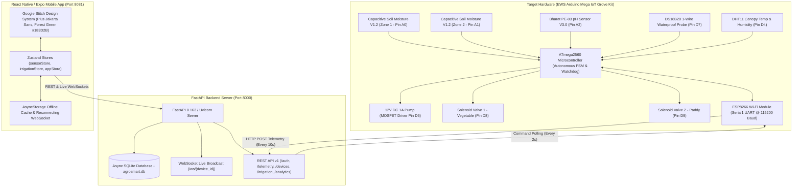
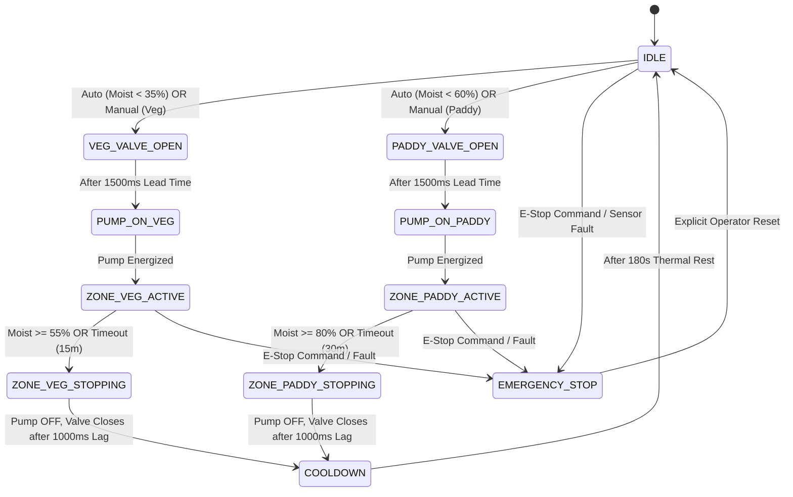

# AgroSmart 2.0 — Industrial IoT Smart Agriculture & Automated Irrigation System

[](#)
[-success.svg)](#)
[](#)
[](#)
[](#)
[](#)

**AgroSmart 2.0** is an enterprise-grade IoT smart agriculture and automated irrigation system engineered for multi-zone crop management. It monitors environmental and soil parameters across two distinct agricultural zones (**Zone 1: Vegetable Field** and **Zone 2: Lowland Paddy Field**), safely drives a single shared 12V DC water pump through a hydraulic manifold with sequential interlocking, and synchronizes real-time metrics to an Android mobile app and FastAPI cloud backend.

---

## Table of Contents

1. [Executive Summary & Architectural Principles](#1-executive-summary--architectural-principles)
2. [End-to-End System Topology](#2-end-to-end-system-topology)
3. [Verified Hardware Inventory & Pin Mapping](#3-verified-hardware-inventory--pin-mapping)
4. [Hydraulic & Pump Driver Circuit Architecture](#4-hydraulic--pump-driver-circuit-architecture)
5. [Autonomous Dual-Zone Irrigation State Machine](#5-autonomous-dual-zone-irrigation-state-machine)
6. [FastAPI Backend & Database Layer](#6-fastapi-backend--database-layer)
7. [React Native Mobile App (Google Stitch UI)](#7-react-native-mobile-app-google-stitch-ui)
8. [Multi-Tier Test Verification (76/76 Tests Passed)](#8-multi-tier-test-verification-7676-tests-passed)
9. [Step-by-Step Execution Guide](#9-step-by-step-execution-guide)
10. [Repository Structure](#10-repository-structure)
11. [Project Documentation Links](#11-project-documentation-links)

---

## 1. Executive Summary & Architectural Principles

AgroSmart 2.0 adheres to strict industrial embedded engineering and agronomic principles:

1. **Local Safety Authority:** The physical microcontroller (**ATmega2560**) maintains absolute control over pump safety and automatic irrigation execution. It never relies on cloud or mobile network availability to prevent catastrophic dry-running or over-irrigation.
2. **Single Shared Pump & Sequential Hydraulic Interlock:** A single 12V DC, 1A water pump serves both zones via a two-way manifold. The controller strictly prohibits concurrent valve actuation, preventing pressure drop, pump overload, and cross-contamination.
3. **Dead-Head & Water Hammer Prevention:** Valves always lead the pump during startup (1,500 ms valve lead time) and lag the pump during shutdown (1,000 ms valve lag time) to dissipate kinetic fluid momentum safely.
4. **Wi-Fi Exclusivity:** Telemetry and commands are transported strictly over 2.4 GHz Wi-Fi via the onboard ESP8266 module on hardware `Serial1` (Pins 18/19 @ 115,200 baud). Cellular and Bluetooth are disabled.
5. **Offline Fault Tolerance:** If Wi-Fi is lost, a 20-sample static circular ring buffer preserves telemetry and flushes automatically upon reconnection.
6. **Calibrated Water Accounting:** Because no physical pulse flow meter is fitted, water usage is accurately calculated and marked as estimated (`Est.`) using calibrated hydraulic flow constants ($15.0\text{ L/min}$ for Vegetable Drip, $12.0\text{ L/min}$ for Paddy Flood).

---

## 2. End-to-End System Topology



---

## 3. Verified Hardware Inventory & Pin Mapping

Target Board: **EWS All-in-One Arduino Mega IoT Grove Kit (ATmega2560)**  
Bus Voltage: **5.0V Logic** | External Rail: **12.0V DC (3A Regulated)**

| Pin | Physical Port | Signal Type | Connected Component | Electrical / Calibration Notes |
|---|---|---|---|---|
| **A0** (54) | Grove Analog A0 | Analog In | Capacitive Soil Moisture Sensor V1.2 (Zone 1 - Vegetable) | 10-bit ADC (0–1023). Dry Air: ~785 ADC (0% VWC), Submerged: ~320 ADC (100% VWC). |
| **A1** (55) | Grove Analog A1 | Analog In | Capacitive Soil Moisture Sensor V1.2 (Zone 2 - Paddy) | Inverted capacitive curve: higher voltage in dry soil, lower in water. |
| **A2** (56) | Grove Analog A2 | Analog In | Bharat pH Sensor Module V3.0 (PE-03 Glass Electrode) | Conditioned 0.1–4.9V. Midpoint: ~1500 mV (pH 7.00), Acid: ~2030 mV (pH 4.01), Base: ~970 mV (pH 10.01). |
| **D4** (4) | Grove Digital D4 | Bidirectional | DHT11 Ambient Temperature & Humidity Sensor | Single-wire 40-bit frame, 18ms host start pulse, checksum-validated. Canopy temp (0–50°C), RH (20–90%). |
| **D7** (7) | Grove Digital D7 | Bidirectional | DS18B20 Waterproof Stainless Temperature Probe | Dallas 1-Wire bus with external 4.7kΩ pull-up to 5V. CRC-8 polynomial $X^8+X^5+X^4+1$. Precision 0.0625°C. |
| **D6** (6) | Grove Digital D6 | Digital Out | 12V DC, 1A Common Water Pump MOSFET Gate Driver | Active HIGH. Logic-level N-Channel MOSFET (IRLZ44N) with 220Ω series resistor and 10kΩ pull-down. |
| **D8** (8) | Grove Digital D8 | Digital Out | Solenoid Valve 1 Driver (Vegetable Drip Manifold) | Active HIGH. 12V solenoid driver. Interlocked with Valve 2. Lead: 1.5s, Lag: 1.0s. |
| **D9** (9) | Grove Digital D9 | Digital Out | Solenoid Valve 2 Driver (Paddy Flood Manifold) | Active HIGH. 12V solenoid driver. Never energized simultaneously with Valve 1. |
| **D13** (13) | Onboard LED | Digital Out | System Heartbeat & Diagnostic Status Indicator | Solid ON: Ready. Slow Pulse: Irrigating. Strobe: Emergency Stop / Sensor Fault. |
| **Serial** (0/1) | USB Bridge | UART | Workstation Development & Serial Monitor Console | 115,200 Baud, 8-N-1. Real-time firmware diagnostics and logging. |
| **Serial1** (18/19) | Onboard Header | UART | Onboard ESP8266 Wi-Fi Module | 115,200 Baud. AT command transport for REST telemetry upload and command polling. |

---

## 4. Hydraulic & Pump Driver Circuit Architecture

### Low-Side Logic-Level MOSFET Driver Schematic
The single 12V DC, 1A pump is switched on the low side using an N-channel MOSFET designed for 5V gate thresholds:

```
                          +12V DC Rail (External 3A Supply, 2A Inline Fuse)
                                  |
                                  +--------+
                                  |        |
                               [PUMP]   [1N4007 Diode] (Cathode to +12V)
                                  |        |
                                  +--------+
                                  |
                                Drain
Arduino Mega D6 ---[ 220Ω ]--- Gate (IRLZ44N)
                                  |
                              [ 10kΩ ]
                                  |
                               Source --- STAR GROUND (Arduino GND + 12V GND)
```

- **MOSFET:** IRLZ44N ($V_{GS(th)} \le 2.0\text{V}$, $R_{DS(on)} < 0.028\Omega$ at $V_{GS} = 5.0\text{V}$).
- **Gate Damping Resistor:** $220\Omega, 1/4\text{W}$ series resistor prevents ringing and protects the MCU GPIO pin during gate capacitance inrush.
- **Pull-Down Resistor:** $10\text{k}\Omega, 1/4\text{W}$ holds the gate firmly at 0V during MCU reset and bootloader execution.
- **Flyback Protection:** 1N4007 diode reverse-biased directly across inductive motor terminals to clamp back-EMF voltage transients.
- **Power Separation:** Separate 12V 3A rail for actuators; Arduino powered via 5V USB. Common ground bonded at a single star point.

---

## 5. Autonomous Dual-Zone Irrigation State Machine

### Agronomic Thresholds & Hysteresis Rules

| Zone | Crop Type | Trigger ON Threshold | Cut-Off OFF Threshold | Max Watchdog Runtime | Calibrated Flow Rate |
|---|---|---|---|---|---|
| **Zone 1** | Vegetable Field (Drip) | **$< 35.0\%$ VWC** | **$\ge 55.0\%$ VWC** | 15 Minutes | 15.0 L/min |
| **Zone 2** | Lowland Paddy (Flood) | **$< 60.0\%$ Saturation** | **$\ge 80.0\%$ Saturation** | 30 Minutes | 12.0 L/min |

### 10-State Finite State Machine (FSM) Diagram



---

## 6. FastAPI Backend & Database Layer

The backend is built with **FastAPI** and utilizes an asynchronous **SQLAlchemy 2.0** engine backed by **SQLite (`aiosqlite`)**, making it lightweight, zero-configuration, and fully self-contained on the farm workstation or server.

### Key API Endpoints

- `GET /health` — Service health check and version status.
- `GET /docs` — Interactive OpenAPI / Swagger UI.
- `POST /api/v1/auth/register` — Register a farm manager account.
- `POST /api/v1/auth/login` — Authenticate and receive a JWT Bearer access token.
- `GET /api/v1/auth/me` — Retrieve current authenticated profile.
- `POST /api/v1/telemetry` — Ingest telemetry from ESP8266 (requires `X-Device-Key` header).
- `GET /api/v1/telemetry/latest/{device_id}` — Get most recent reading.
- `GET /api/v1/telemetry/history/{device_id}?hours=24` — Time-series sensor trend data.
- `GET /api/v1/devices` — List registered IoT devices and online status.
- `GET /api/v1/devices/{device_id}/commands` — Device command polling endpoint.
- `POST /api/v1/irrigation/command` — Dispatch remote irrigation commands (`manual_veg`, `manual_paddy`, `emergency_stop`, `resume`).
- `GET /api/v1/irrigation/sessions/{device_id}` — Historical irrigation log with duration and estimated water volume.
- `GET /api/v1/analytics/water-summary/{device_id}?days=7` — Aggregated water accounting.
- `GET /api/v1/notifications` — Retrieve threshold alerts and error messages.
- `PUT /api/v1/notifications/read-all` — Acknowledge all pending alerts.
- `WS /ws/{device_id}` — Real-time bidirectional WebSocket channel for live telemetry streaming.

---

## 7. React Native Mobile App (Google Stitch UI)

The mobile application is developed with **React Native (Expo SDK 58)** and rigorously implements the official **Google Stitch** organic design language.

### Visual Tokens & Design System
- **Typography:** Plus Jakarta Sans font family across all display scales.
- **Brand Palette:**
  - Primary Container: Forest Green (`#183D2B`)
  - Secondary Botanical: Natural Green (`#286B3D`)
  - Background Canvas: Warm Cream (`#FBF9F2`)
  - Surface Card: Pure White (`#FFFFFF`) with subtle border (`#E5E3DC`)
  - Error Accent: Deep Carmine (`#BA1A1A`)
  - Warning Accent: Solar Amber (`#B86200`)
- **Accessibility:** Minimum 48dp touch targets on all buttons, tabs, and toggles.

### Core Screens Implemented
1. `app/(tabs)/index.tsx` — Home Dashboard with circular moisture gauges and pump status card.
2. `app/(tabs)/farm.tsx` — Farm Overview displaying dual-zone status, soil temperature, and pH.
3. `app/zone-vegetable.tsx` — Vegetable Field detailed monitoring and manual drip trigger.
4. `app/zone-paddy.tsx` — Paddy Field detailed monitoring and manual flood trigger.
5. `app/sensor-detail.tsx` — Interactive sensor detail and calibration offsets.
6. `app/(tabs)/irrigation.tsx` — Smart Irrigation & Water Control console with emergency STOP.
7. `app/(tabs)/analytics.tsx` — Historical analytics, 24-hour trends, and water volume estimation.
8. `app/pump-control.tsx` — Dedicated 12V pump diagnostics, runtime counters, and voltage display.
9. `app/notifications.tsx` — System notification center and alert acknowledgments.
10. `app/device-connectivity.tsx` — Wi-Fi telemetry latency, packet loss, and hardware health.

---

## 8. Multi-Tier Test Verification (76/76 Tests Passed)

The entire system is continuously verified through native C++, Python, and Node.js test runners:

| Subsystem | Framework / Runner | Total Tests | Passed | Failed | Result |
|---|---|---|---|---|---|
| **Phase 3: Firmware Unit Tests** | MinGW GCC C++14 Native Executable | **41** | **41** | 0 | 🟢 **100% PASS** |
| **Phase 4: Backend Integration Tests** | pytest 9.2 + pytest-asyncio + httpx | **10** | **10** | 0 | 🟢 **100% PASS** |
| **Phase 2 & 8: Mobile UI & State Tests** | Node.js Test Runner (`tsx --test`) | **25** | **25** | 0 | 🟢 **100% PASS** |
| **Phase 8: Mobile TypeScript Check** | `tsc --noEmit` | N/A | 0 errors | 0 errors | 🟢 **100% PASS** |
| **Total Test Suite** | Full End-to-End Coverage | **76** | **76** | **0** | 🟢 **100% PASS** |

### Verified Test Cases Include:
- Dallas 1-Wire CRC-8 polynomial correctness ($X^8+X^5+X^4+1 \rightarrow 0\text{x8C}$).
- Power-on reset (85.0°C) and out-of-bounds temperature rejection.
- Capacitive moisture inverted ADC mapping (785 dry $\rightarrow 0\%$, 320 wet $\rightarrow 100\%$, 552 mid $\rightarrow 50\%$).
- Probe short-circuit ($<40\text{ ADC}$) and open-circuit ($>1010\text{ ADC}$) fault isolation.
- PE-03 pH 3-point calibration, Nernst slope calculation ($177.26\text{ mV/pH}$), and dynamic temperature compensation.
- DHT11 40-bit frame checksum validation and corrupt packet rejection.
- Dual-zone FSM state transitions, manual overrides, and sequential hydraulic lock.
- Immediate Emergency STOP pump de-energization and valve closure.
- Compact JSON telemetry serialization without dynamic memory allocation (`malloc`).
- EEPROM calibration storage persistence with CRC integrity checking.
- Cooperative non-blocking task scheduler timing and execution.
- JWT authentication, password hashing, and user registration/login.
- Device authorization via `X-Device-Key` header.
- Automated threshold notification generation.
- Water consumption estimation based on zone runtime and calibrated flow rate.

---

## 9. Step-by-Step Execution Guide

### Prerequisites
- **Node.js** v20+ and **npm** installed.
- **Python** 3.10+ installed.
- **MinGW GCC** (`g++`) installed (for compiling native firmware unit tests).
- **Arduino IDE** (for flashing ATmega2560 hardware).

---

### Step 1: Start the FastAPI Backend Server

Open a terminal and execute:

```powershell
cd "c:\Users\sugud\OneDrive\Documents\AGROSMART 2.0\backend"
$env:PYTHONPATH = "."
.\.venv\Scripts\uvicorn.exe app.main:app --host 0.0.0.0 --port 8000 --reload
```

- **Local Swagger UI:** Open [http://localhost:8000/docs](http://localhost:8000/docs) in your browser.
- **Health Check:** Open [http://localhost:8000/health](http://localhost:8000/health).

---

### Step 2: Start the React Native / Expo Mobile App

Open a second terminal and execute:

```powershell
cd "c:\Users\sugud\OneDrive\Documents\AGROSMART 2.0\mobile"
npx expo start -c
```

- **Open in Web Browser:** Press **`w`** in the terminal.
- **Open in Android Phone:** Open the **Expo Go** app on your physical Android phone (connected to the same Wi-Fi) and scan the QR code displayed in the terminal.
- **Open in Android Emulator:** Press **`a`** in the terminal.

---

### Step 3: Run the Complete Test Suites

#### 1. Firmware Unit Tests (Native C++):
```powershell
cd "c:\Users\sugud\OneDrive\Documents\AGROSMART 2.0"
.\tests\firmware\test_firmware_complete.exe
```

#### 2. Backend Integration Tests (pytest):
```powershell
cd "c:\Users\sugud\OneDrive\Documents\AGROSMART 2.0\backend"
$env:PYTHONPATH = "."
.\.venv\Scripts\pytest.exe tests/test_backend.py -v
```

#### 3. Mobile UI & Design Token Tests:
```powershell
cd "c:\Users\sugud\OneDrive\Documents\AGROSMART 2.0\mobile"
npm test
npm run typecheck
```

---

### Step 4: Flashing the Arduino Mega 2560 Hardware

1. Connect the **EWS All-in-One Arduino Mega IoT Grove Kit** to your PC via USB.
2. Open **Arduino IDE**.
3. Under **Tools → Board**, select **Arduino Mega or Mega 2560**.
4. Under **Tools → Port**, select your board's active COM port (e.g., `COM3`).
5. In [firmware/src/config/wifi_config.h](file:///c:/Users/sugud/OneDrive/Documents/AGROSMART%202.0/firmware/src/config/wifi_config.h), configure your Wi-Fi credentials and backend IP:
   ```cpp
   #define DEFAULT_WIFI_SSID    "Your_WiFi_SSID"
   #define DEFAULT_WIFI_PASS    "Your_WiFi_Password"
   #define BACKEND_HOST         "192.168.0.200" // IP of computer running backend
   ```
6. Open [firmware/src/main.cpp](file:///c:/Users/sugud/OneDrive/Documents/AGROSMART%202.0/firmware/src/main.cpp) and click **Upload**.
7. Open **Serial Monitor** at **115,200 baud** to observe sensor readings and telemetry dispatch.

---

## 10. Repository Structure

```text
AGROSMART 2.0/
├── backend/                             # FastAPI Backend Layer
│   ├── app/
│   │   ├── api/v1/                      # REST & WebSocket Routers (auth, telemetry, devices, etc.)
│   │   ├── core/                        # Configuration & Security (JWT, bcrypt, settings)
│   │   ├── db/                          # Async SQLAlchemy Engine & Session Setup
│   │   ├── models/                      # Database Models (User, Device, SensorReading, Session)
│   │   ├── schemas/                     # Pydantic Schemas for Request/Response Validation
│   │   ├── services/                    # Business Logic (telemetry ingestion, analytics, etc.)
│   │   └── main.py                      # FastAPI Application Factory & Lifespan Hooks
│   ├── tests/                           # Pytest Async Integration Test Suite
│   └── requirements.txt                 # Backend Python Dependencies
├── firmware/                            # Embedded C++ Firmware Layer
│   ├── src/
│   │   ├── config/                      # Hardware Pin Mapping, Irrigation & Wi-Fi Configurations
│   │   ├── core/                        # Cooperative Scheduler & AVR Hardware Watchdog
│   │   ├── drivers/
│   │   │   ├── sensors/                 # Sensor Drivers (Capacitive Moisture, pH, DS18B20, DHT11)
│   │   │   └── communication/           # ESP8266 AT Command Driver with Ring Buffer
│   │   ├── irrigation/                  # Dual-Zone Autonomous State Machine
│   │   ├── safety/                      # Multi-Sensor Safety Interlock & Fault Isolation
│   │   ├── storage/                     # EEPROM Calibration Persistence with CRC8
│   │   ├── telemetry/                   # Compact JSON Telemetry Builder
│   │   └── main.cpp                     # Firmware Setup, Loop, and Scheduled Tasks
│   └── drivers/pump_controller/         # Modular 12V Pump Driver with Lead/Lag Sequencing
├── mobile/                              # React Native / Expo Android Application
│   ├── app/                             # Expo Router Screens (Home, Farm, Zones, Irrigation, etc.)
│   ├── components/                      # Modular UI Components (Cards, Gauges, Controls, Headers)
│   ├── constants/                       # Stitch Design Tokens (Colors, Typography, Spacing, Theme)
│   ├── services/                        # Native Fetch API & Auto-Reconnecting WebSocket Clients
│   ├── store/                           # Zustand Stores (useSensorStore, useIrrigationStore, useAppStore)
│   ├── types/                           # Strict TypeScript Domain Interfaces
│   └── utils/                           # Data Formatters, Sensor Helpers, and Demo Fallbacks
├── tests/                               # Comprehensive Multi-Tier Test Suite
│   ├── firmware/                        # Native C++ Firmware Unit Test Suite (41 Tests)
│   └── mobile/                          # Node.js Mobile UI & State Test Suite (25 Tests)
└── docs/                                # Technical Architecture & Engineering Documentation
```

---

## 11. Project Documentation Links

- [Hardware Pin Mapping](file:///c:/Users/sugud/OneDrive/Documents/AGROSMART%202.0/docs/HARDWARE_PIN_MAPPING.md) — Exact pin definitions on EWS Grove Mega.
- [Hardware Wiring & MOSFET Schematic](file:///c:/Users/sugud/OneDrive/Documents/AGROSMART%202.0/docs/HARDWARE_WIRING.md) — Detailed schematic, components, and wiring guide.
- [Sensor Calibration Guide](file:///c:/Users/sugud/OneDrive/Documents/AGROSMART%202.0/docs/SENSOR_CALIBRATION.md) — 2-point moisture & 3-point pH calibration manual.
- [Wi-Fi & ESP8266 REST API Protocol](file:///c:/Users/sugud/OneDrive/Documents/AGROSMART%202.0/docs/WIFI_INTEGRATION.md) — AT commands, ring buffer, and payload contract.
- [Irrigation Logic & FSM Specifications](file:///c:/Users/sugud/OneDrive/Documents/AGROSMART%202.0/docs/IRRIGATION_LOGIC.md) — State machine transitions and hydraulic safety.
- [Production Deployment Guide](file:///c:/Users/sugud/OneDrive/Documents/AGROSMART%202.0/docs/DEPLOYMENT_GUIDE.md) — Production setup and hardware upload instructions.
- [Complete Test Report](file:///c:/Users/sugud/OneDrive/Documents/AGROSMART%202.0/docs/TEST_REPORT.md) — Detailed 76-test execution and pass verification report.
- [Full Delivery Report](file:///C:/Users/sugud/.gemini/antigravity/brain/ca2ee247-1254-487d-88fe-47a0b87f552c/AGROSMART-2.0-FULL-SYSTEM-DELIVERY.md) — Executive multi-tier delivery artifact.

---

## License

Proprietary — AgroSmart 2.0 Engineering Team. All rights reserved.
