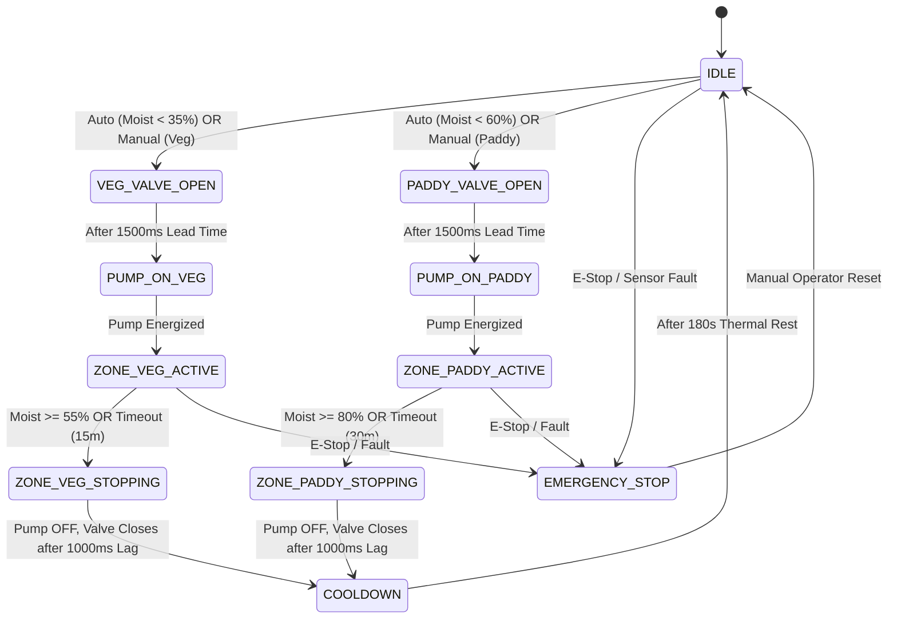

# AgroSmart 2.0 – Dual-Zone Autonomous Irrigation Logic & State Machine

## 1. Executive Summary

AgroSmart 2.0 manages two distinct crop zones with conflicting agronomic water requirements through a **single common 12V DC, 1A water pump** and two independently driven solenoid valves:

- **Zone 1: Vegetable Field** (Drip irrigation: high frequency, low volume, strict upper threshold to prevent root rot).
- **Zone 2: Lowland Paddy Field** (Flood irrigation: high saturation, prolonged flood cycles, submerged root crown).

The physical controller (ATmega2560) exercises **sole and absolute safety authority**. Even if cloud connectivity is severed, the firmware enforces local thresholds, sequential locks, lead/lag timing, and watchdog timers autonomously.

---

## 2. Agronomic Hysteresis Thresholds

| Zone | Crop Type | Trigger ON Threshold | Cut-Off OFF Threshold | Max Watchdog Runtime | Calibrated Flow Rate ($L/min$) |
|---|---|---|---|---|---|
| **Zone 1** | Vegetables (Solanaceae / Cucurbits) | **$< 35.0\%$ VWC** | **$\ge 55.0\%$ VWC** | 15 Minutes | 15.0 L/min |
| **Zone 2** | Lowland Paddy (Oryza sativa) | **$< 60.0\%$ Saturation** | **$\ge 80.0\%$ Saturation** | 30 Minutes | 12.0 L/min |

---

## 3. Finite State Machine (FSM) Diagram

---

## 4. Hydraulic & Electrical Protections

1. **Dead-Head Prevention (Valve Lead Time):**
   Before the 12V pump MOSFET is energized, the destination zone's solenoid valve is opened for **1500 ms** to ensure a non-pressurized fluid exit path exists.

2. **Water Hammer Suppression (Valve Lag Time):**
   When irrigation terminates, the pump MOSFET is de-energized first. The valve remains open for **1000 ms** to dissipate residual kinetic momentum and fluid pressure before sealing.

3. **Sequential Hydraulic Lock:**
   Because only one common pump is installed, the state machine strictly prevents concurrent irrigation of both zones. If both zones request water simultaneously, Zone 1 (Vegetable) takes precedence; Zone 2 (Paddy) is serviced only after Zone 1 finishes and the cooldown timer elapses.

4. **Thermal Cooldown (3 Minutes):**
   Between any consecutive pump activations, a mandatory 180-second thermal cooldown timer (`PUMP_COOLDOWN_TIME_MS`) is enforced to prevent pump motor and MOSFET thermal breakdown.
