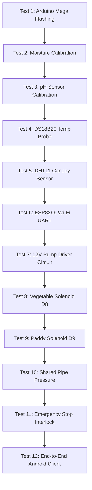

# AGROSMART 2.0 – HARDWARE COMMISSIONING & FIELD VERIFICATION MANUAL

**Document Version:** 2.1.0  
**Target Hardware:** EWS All-in-One Arduino Mega IoT Grove Kit (ATmega2560 @ 16MHz, 5V)  
**Safety Classification:** Level 2 Electrical & Pressurized Hydraulic Interlock  
**Status:** STEP-BY-STEP FIELD PROTOCOL  

---

## 1. Safety Rules & Pre-Flight Precautions

> [!CAUTION]
> **ELECTRICAL HAZARD & OVERCURRENT RISK:**
> 1. Never connect the 12V DC power supply to the Arduino Mega 5V or 3.3V rail.
> 2. The single water pump draws $\approx 1.0\,\text{A}$ at 12V. An Arduino GPIO pin can supply a maximum of $20\,\text{mA}$ ($40\,\text{mA}$ absolute maximum). Powering the pump or solenoid coils directly from an Arduino digital pin will permanently destroy the ATmega2560 microcontroller.
> 3. Always ensure a 1N4007 or 1N5819 flyback diode is soldered across inductive loads (pump motor and solenoid valves).
> 4. Ensure a 2.0A inline fast-blow fuse is installed on the +12V positive rail before powering any actuator.

> [!WARNING]
> **HYDRAULIC DEADHEAD RISK:**
> The system utilizes **ONE common 12V DC pump** and a single manifold splitting into Vegetable and Paddy branches. Operating the pump with both branch solenoid valves closed will cause rapid deadhead pressure accumulation, pipe rupture, or pump burnout. The firmware enforces a 1500 ms valve lead time; verify physical valve opening before running the pump.

---

## 2. Commissioning Sequence (12 Mandatory Tests)



---

### Test 1: Arduino Mega Connection & Firmware Flashing

- **Status:** HARDWARE PENDING
- **Required Equipment:**
  - EWS Arduino Mega 2560 board.
  - Standard USB-A to USB-B cable.
  - PC with Arduino IDE or Arduino CLI (`arduino-cli`) / AVRDUDE installed.
- **Wiring / Setup:**
  - Connect Arduino Mega via USB to PC.
  - Disconnect all 12V power sources and external actuators during flashing.
- **Exact Test Procedure:**
  1. Identify COM port using Device Manager (e.g., `COM3` on Windows).
  2. Compile `firmware/src/main.cpp` for target `arduino:avr:mega:cpu=atmega2560`.
  3. Upload firmware via USB:
     ```bash
     arduino-cli compile --fqbn arduino:avr:mega firmware/src/main.cpp
     arduino-cli upload -p COM3 --fqbn arduino:avr:mega firmware/src/main.cpp
     ```
  4. Open Serial Monitor at `115200 baud`.
- **Expected Result:**
  - Pin 13 LED blinks twice on boot.
  - Serial console outputs:
    `[BOOT] AgroSmart 2.0 Firmware Initializing...`
    `[HAL] Watchdog timer enabled (8000ms)`
    `[HAL] Actuators initialized to safe LOW state`
- **Pass / Fail Criteria:**
  - **PASS:** Firmware uploads with 0 errors; Serial banner printed at 115200 baud; pins D6, D8, D9 measure $0.0\,\text{V}$.
  - **FAIL:** Upload timeout, avrdude sync error, or actuator pins float HIGH during boot.

---

### Test 2: Capacitive Soil Moisture Sensor Calibration (V1.2)

- **Status:** HARDWARE PENDING
- **Required Equipment:**
  - Two Capacitive Soil Moisture Sensors V1.2.
  - 3-pin Grove cables.
  - Cup of dry air / dry clean soil.
  - Cup of clean water (at room temperature).
  - Digital Multimeter (DMM).
- **Wiring / Setup:**
  - Sensor 1 (Vegetable): Connect to Grove Analog Port `A0` (VCC: 5V, GND: GND, SIG: A0/Pin 54).
  - Sensor 2 (Paddy): Connect to Grove Analog Port `A1` (VCC: 5V, GND: GND, SIG: A1/Pin 55).
- **Exact Test Procedure:**
  1. Hold Sensor 1 in ambient air (0% moisture). Record raw 10-bit ADC value ($ADC_{\text{air}}$).
  2. Submerge the sensor blade into water up to the white indicator line (100% moisture). Do not submerge components above the line. Record raw ADC ($ADC_{\text{water}}$).
  3. Repeat steps 1–2 for Sensor 2 on `A1`.
  4. Disconnect signal wire to verify disconnection fault handling ($ADC > 900$).
- **Expected Result:**
  - $ADC_{\text{air}}$: $780 - 870$ counts ($3.8\,\text{V} - 4.25\,\text{V}$).
  - $ADC_{\text{water}}$: $300 - 380$ counts ($1.45\,\text{V} - 1.85\,\text{V}$).
  - Calculated moisture displays $0.0\% \pm 3\%$ in air and $100.0\% \pm 3\%$ in water.
- **Pass / Fail Criteria:**
  - **PASS:** Inverted capacitive curve confirmed ($ADC_{\text{air}} > ADC_{\text{water}}$ by at least 400 counts); disconnected pin triggers `FAULT` bit.
  - **FAIL:** Inverted slope ($ADC_{\text{water}} > ADC_{\text{air}}$), zero delta ($<100$ counts difference), or sensor heating up.

---

### Test 3: Bharat pH Sensor Module V3.0 Calibration

- **Status:** HARDWARE PENDING
- **Required Equipment:**
  - Bharat pH Sensor Module V3.0.
  - PE-03 glass pH electrode with BNC connector.
  - Standard buffer solutions: $\text{pH } 7.00$ (Neutral) and $\text{pH } 4.01$ (Acidic).
  - Deionized / distilled water for rinsing.
  - Precision flathead screwdriver for potentiometer adjustment.
  - Digital Multimeter (DMM).
- **Wiring / Setup:**
  - Bharat pH module VCC to Arduino 5V, GND to Arduino GND.
  - Analog OUT to Grove Analog Port `A2` (Pin 56).
  - Connect PE-03 BNC plug into module BNC jack securely.
- **Exact Test Procedure:**
  1. Remove protective cap from PE-03 electrode. Rinse bulb with deionized water and blot gently.
  2. Submerge bulb in $\text{pH } 7.00$ buffer solution. Wait 60 seconds for equilibrium.
  3. Measure voltage at pin `A2` with DMM. Adjust onboard potentiometer $R_{\text{offset}}$ until voltage reads exactly $2.500\,\text{V} \pm 0.010\,\text{V}$ (or $1500\,\text{mV}$ conditioned offset depending on module jumper).
  4. Rinse electrode thoroughly with deionized water.
  5. Submerge bulb in $\text{pH } 4.01$ buffer solution. Wait 60 seconds.
  6. Measure voltage at pin `A2`. Record slope voltage ($V_{\text{pH4}}$).
- **Expected Result:**
  - $\text{pH } 7.00$ buffer yields $2.50\,\text{V}$ (or $1500\,\text{mV}$ offset).
  - $\text{pH } 4.01$ buffer yields $3.00 - 3.10\,\text{V}$ (negative sensitivity $\approx -59.16\,\text{mV/pH}$ at 25°C).
  - Serial monitor outputs $\text{pH } 7.0 \pm 0.1$ and $\text{pH } 4.0 \pm 0.1$.
- **Pass / Fail Criteria:**
  - **PASS:** Stable reading within $\pm 0.15\,\text{pH}$; linear response across buffer range; temperature compensation adjusts slope.
  - **FAIL:** Potentiometer cannot reach $2.50\,\text{V}$; voltage drifts $>0.1\,\text{V}$ in steady buffer; zero response to buffer change.
- **Safety:** Do not touch glass bulb with fingers. Store electrode in 3M KCl storage solution.

---

### Test 4: DS18B20 Soil Temperature Sensor Verification

- **Status:** HARDWARE PENDING
- **Required Equipment:**
  - Waterproof DS18B20 stainless steel temperature probe.
  - $4.7\,\text{k}\Omega$ pull-up resistor (between 5V and DATA).
  - Reference laboratory thermometer or ice bath / warm water.
- **Wiring / Setup:**
  - Red wire to 5V rail.
  - Black wire to GND.
  - Yellow/White data wire to Grove Digital Port `D7` (Pin 7).
  - Confirm $4.7\,\text{k}\Omega$ pull-up resistor connects DATA to 5V rail.
- **Exact Test Procedure:**
  1. Power up Arduino and check Serial monitor for 1-Wire device ROM detection.
  2. Read ambient room temperature.
  3. Place stainless probe into ice water ($0.0^\circ\text{C}$ reference) and warm water ($40.0^\circ\text{C}$).
  4. Disconnect DATA line while running to verify bus timeout and disconnect detection.
- **Expected Result:**
  - Ambient reads $20^\circ\text{C} - 30^\circ\text{C}$ matching reference thermometer within $\pm 0.5^\circ\text{C}$.
  - CRC check reports `CRC OK (0x8C)` on raw scratchpad reads.
  - Disconnection returns $-127.0^\circ\text{C}$ and sets sensor `FAULT` flag.
- **Pass / Fail Criteria:**
  - **PASS:** Temperature tracks within $\pm 0.5^\circ\text{C}$; CRC passes; invalid reads rejected.
  - **FAIL:** Returns $85.0^\circ\text{C}$ continuously (power-on reset unread error), CRC failures, or bus freeze.

---

### Test 5: DHT11 Ambient Canopy Temperature & Humidity Verification

- **Status:** HARDWARE PENDING
- **Required Equipment:**
  - DHT11 sensor module (with internal pull-up resistor).
  - 3-pin Grove cable.
  - Reference hygrometer/thermometer.
- **Wiring / Setup:**
  - Connect to Grove Digital Port `D4` (Pin 4). VCC: 5V, GND: GND, SIG: Pin 4.
- **Exact Test Procedure:**
  1. Boot Arduino and observe DHT11 sampling at 2000 ms intervals (DHT11 maximum sampling rate is 0.5 Hz).
  2. Breathe gently near the sensor grid to verify humidity increase.
- **Expected Result:**
  - Relative Humidity: $20\% - 90\%$ ($\pm 5\%$).
  - Temperature: $0^\circ\text{C} - 50^\circ\text{C}$ ($\pm 2^\circ\text{C}$).
  - 40-bit frame checksum validation passes.
- **Pass / Fail Criteria:**
  - **PASS:** Humidity increases on moisture exposure; temperature matches reference within $\pm 2^\circ\text{C}$; checksum valid.
  - **FAIL:** Checksum error warnings in serial log; values stuck at 0% or 99%; no response to start pulse.

---

### Test 6: ESP8266 Wi-Fi Module UART Communication

- **Status:** HARDWARE PENDING
- **Required Equipment:**
  - Onboard ESP8266 Wi-Fi module on EWS Mega shield.
  - Wi-Fi Access Point (2.4 GHz 802.11b/g/n, WPA2-PSK).
  - PC / Laptop running FastAPI backend on LAN.
- **Wiring / Setup:**
  - Module RX connected to Mega `TX1` (Pin 18).
  - Module TX connected to Mega `RX1` (Pin 19).
  - Module powered via dedicated 3.3V high-current regulator on Grove shield (ESP8266 requires up to 250 mA peak during RF transmit).
- **Exact Test Procedure:**
  1. Configure `DEFAULT_WIFI_SSID` and `DEFAULT_WIFI_PASS` in `firmware/src/config/wifi_config.h`.
  2. Set `BACKEND_HOST` to PC LAN IP (e.g. `192.168.0.200`) and `BACKEND_PORT` to `8000`.
  3. Flash firmware and observe serial monitor at 115200 baud.
  4. Check for `AT+CWJAP` association and IP acquisition: `WIFI GOT IP`.
  5. Check backend FastAPI terminal logs for incoming `POST /api/v1/telemetry/ingest`.
- **Expected Result:**
  - ESP8266 answers `AT` with `OK`.
  - Joins AP within 10 seconds; assigned DHCP IP.
  - Transmits HTTP/1.1 POST telemetry packet every 5000 ms.
  - Disconnecting AP triggers offline queueing (up to 20 frames); reconnecting AP flushes queue.
- **Pass / Fail Criteria:**
  - **PASS:** HTTP status `200 OK` received from backend; telemetry updates in database; offline queue works.
  - **FAIL:** Serial timeout on `AT+CIPSTART`; ESP8266 brownout resets during transmission (check 3.3V rail); baud rate mismatch.

---

### Test 7: 12V DC, 1A Common Pump MOSFET Driver Circuit

- **Status:** HARDWARE PENDING
- **Required Equipment:**
  - 12V DC, 1A submersible water pump.
  - Logic-Level N-Channel MOSFET (IRLZ44N or FQP30N06L).
  - $220\,\Omega$ series gate resistor.
  - $10\,\text{k}\Omega$ gate pull-down resistor.
  - 1N4007 flyback diode.
  - Regulated 12V DC, 3A external power supply.
  - 2A fast-blow inline fuse.
  - Digital Multimeter & Oscilloscope (optional).
- **Wiring / Setup:**
  - Gate: Arduino Pin `D6` via $220\,\Omega$ resistor; $10\,\text{k}\Omega$ from Gate to GND.
  - Drain: Negative terminal of 12V pump motor.
  - Source: Star-ground connection (bonded to 12V PSU negative and Arduino GND).
  - Pump Positive: +12V rail via 2A inline fuse.
  - Flyback Diode: Cathode (banded end) to +12V, Anode to MOSFET Drain.
- **Exact Test Procedure:**
  1. Measure PSU output with DMM before connecting: must read $12.0\,\text{V} \pm 0.3\,\text{V}$.
  2. Connect test load (12V automotive bulb or pump submerged in test bucket).
  3. Execute manual pump toggle command via Serial CLI or test script:
     `PUMP_ON` $\to$ verify Gate pin `D6` reads $5.0\,\text{V}$ and pump spins.
     `PUMP_OFF` $\to$ verify Gate pin `D6` reads $0.0\,\text{V}$ and pump cuts immediately.
  4. Measure operating current using DMM in 10A current mode: must read $\le 1.1\,\text{A}$.
- **Expected Result:**
  - Clean switching with zero chattering.
  - MOSFET remains cool to touch ($<40^\circ\text{C}$) under continuous 5-minute run.
  - Back-EMF spike clamped to $<14\,\text{V}$ by 1N4007 diode.
- **Pass / Fail Criteria:**
  - **PASS:** Pump starts and stops cleanly; gate voltage reaches $4.8\,\text{V}-5.0\,\text{V}$; no reset on Arduino when motor engages.
  - **FAIL:** Arduino resets or brownouts when pump starts (indicates missing flyback diode or ground loop); MOSFET overheats ($>60^\circ\text{C}$ indicates non-logic-level MOSFET); current exceeds 1.5A.

---

### Test 8: Vegetable Branch Solenoid Valve Driver (Zone 1)

- **Status:** HARDWARE PENDING
- **Required Equipment:**
  - 12V DC normally-closed solenoid valve (1/2" NPT or BSP).
  - MOSFET / Relay driver on Grove Digital Port `D8` (Pin 8).
  - 1N4007 flyback diode across solenoid terminals.
  - 12V DC power bus.
- **Wiring / Setup:**
  - Valve coil connected to +12V and driver drain/contact.
  - Diode cathode to +12V, anode to driver switched line.
  - Driver control line connected to Arduino Pin `D8`.
- **Exact Test Procedure:**
  1. Send manual actuation command: `VALVE_VEG_OPEN`.
  2. Verify Pin `D8` transitions from $0.0\,\text{V}$ to $5.0\,\text{V}$.
  3. Listen for distinct physical solenoid plunger click.
  4. Blow compressed air or low-pressure water through inlet to verify open passage.
  5. Send command: `VALVE_VEG_CLOSE`. Verify plunger seats and passage closes.
- **Expected Result:**
  - Valve opens fully on HIGH and closes completely on LOW.
  - Coil draws $300 - 500\,\text{mA}$ at 12V DC.
- **Pass / Fail Criteria:**
  - **PASS:** Solenoid actuates reliably 10 consecutive times without sticking; coil stays within operating temperature ($<55^\circ\text{C}$).
  - **FAIL:** Plunger fails to pull in; valve remains mechanically stuck; driver output drops below 10V under coil load.

---

### Test 9: Paddy Branch Solenoid Valve Driver (Zone 2)

- **Status:** HARDWARE PENDING
- **Required Equipment:**
  - Second 12V DC normally-closed solenoid valve.
  - MOSFET / Relay driver on Grove Digital Port `D9` (Pin 9).
  - 1N4007 flyback diode across solenoid terminals.
- **Wiring / Setup:**
  - Valve coil connected to +12V and driver switched line.
  - Driver control line connected to Arduino Pin `D9`.
- **Exact Test Procedure:**
  1. Send manual actuation command: `VALVE_PADDY_OPEN`.
  2. Verify Pin `D9` transitions from $0.0\,\text{V}$ to $5.0\,\text{V}$.
  3. Verify physical plunger engagement and open flow.
  4. Send command: `VALVE_PADDY_CLOSE`. Verify closure.
- **Pass / Fail Criteria:**
  - **PASS:** Distinct click; passage opens/closes on command; current within $300 - 500\,\text{mA}$.
  - **FAIL:** No physical actuation; valve leaks or fails to close.
- **Special Instruction:** If second solenoid valve is physically unavailable on the bench, mark Test 9 as **BLOCKED** and independent zone irrigation as **NOT HARDWARE VERIFIED**.

---

### Test 10: Shared-Pipe Hydraulic Leakage & Pressure Testing

- **Status:** HARDWARE PENDING
- **Required Equipment:**
  - Common intake water reservoir (min. 10 liters).
  - Submersible pump submerged in reservoir.
  - Common manifold with tee splitter feeding Branch 1 (Vegetable Drip) and Branch 2 (Paddy Basin).
  - Solenoids 1 & 2 plumbed to respective branches.
  - Inline pressure gauge ($0 - 60\,\text{PSI}$) on common manifold.
- **Wiring / Setup:**
  - Complete hydraulic plumbing assembled with hose clamps and PTFE thread seal tape.
- **Exact Test Procedure:**
  1. **Valve Lead Time Check:** Dispatch `START_CYCLE_VEG`.
     - Confirm Solenoid 1 (`D8`) opens.
     - Verify clock: Pump (`D6`) must NOT energize until exactly $1500\,\text{ms}$ after Solenoid 1 opened.
  2. **Hydraulic Run:** Let pump run for 60 seconds.
     - Inspect manifold, tee splitter, and solenoid fittings for water weeping or droplets.
     - Verify pressure gauge reads nominal operating pressure ($15 - 25\,\text{PSI}$).
     - Verify water exits ONLY from Vegetable drip emitters. Confirm zero leakage into Paddy branch.
  3. **Valve Lag Time Check:** Dispatch `STOP_CYCLE_VEG`.
     - Confirm Pump (`D6`) cuts power immediately ($t = 0$).
     - Verify Solenoid 1 (`D8`) remains open for exactly $1000\,\text{ms}$ lag to vent pressure, then closes.
     - Observe pressure gauge to ensure no water hammer shockwave.
  4. **Sequential Switchover Test:** Dispatch `START_CYCLE_PADDY` while Zone 1 is stopping.
     - Confirm system enters `COOLDOWN` state ($5000\,\text{ms}$ minimum pump rest).
     - Confirm Solenoids 1 and 2 are NEVER open at the same instant.
- **Expected Result:**
  - Zero hydraulic deadhead; pressure stays below $30\,\text{PSI}$.
  - Zero leaks under continuous pressure.
  - Mutual exclusion strictly maintained.
- **Pass / Fail Criteria:**
  - **PASS:** Zero leaks; pump never runs against closed valves; valve lead (1500ms) and lag (1000ms) verified; no water hammer.
  - **FAIL:** Any pipe joint leak; pump starts before valve opens; simultaneous valve opening detected.

---

### Test 11: Emergency Stop & Fault Recovery Verification

- **Status:** HARDWARE PENDING
- **Required Equipment:**
  - Fully assembled system running active irrigation cycle.
  - Physical Emergency Stop button (active-low interrupt or mobile app command).
- **Exact Test Procedure:**
  1. Initiate active pumping in Zone 1 (`PUMP_ON_VEG`).
  2. Trigger Emergency Stop via:
     - Mobile App red STOP button.
     - Backend API: `POST /api/v1/irrigation/command {"action": "EMERGENCY_STOP"}`.
     - Disconnecting soil moisture sensor wire (simulating cable cut).
  3. Measure voltages at pins `D6` (Pump), `D8` (Valve 1), and `D9` (Valve 2) with oscilloscope/DMM.
- **Expected Result:**
  - Pins `D6`, `D8`, `D9` drop to $0.0\,\text{V}$ in $<5\,\text{ms}$.
  - State machine locks into `EMERGENCY_STOP` state.
  - System refuses any new irrigation start commands until explicit `RESUME` command is issued.
  - If Wi-Fi drops during an active cycle, local firmware watchdog terminates cycle if duration exceeds `MAX_RUNTIME` ($600\,\text{s}$).
- **Pass / Fail Criteria:**
  - **PASS:** All actuators de-energize instantly; state locks; autonomous watchdog functions offline.
  - **FAIL:** Actuators remain energized; pump continues running; system resumes without reset.

---

### Test 12: End-to-End Android Client Live Verification

- **Status:** HARDWARE PENDING
- **Required Equipment:**
  - Physical Android smartphone running Android 11.0+.
  - Expo Go installed on device.
  - Laptop / server running FastAPI backend (`uvicorn app.main:app --host 0.0.0.0 --port 8000`).
  - Active 2.4 GHz Wi-Fi network connecting phone, PC, and Arduino Mega.
- **Exact Test Procedure:**
  1. Start FastAPI backend on PC:
     ```powershell
     cd "c:\Users\sugud\OneDrive\Documents\AGROSMART 2.0\backend"
     $env:PYTHONPATH = "."
     .\.venv\Scripts\uvicorn.exe app.main:app --host 0.0.0.0 --port 8000
     ```
  2. Start Expo Metro Bundler in mobile directory:
     ```powershell
     cd "c:\Users\sugud\OneDrive\Documents\AGROSMART 2.0\mobile"
     npx expo start -c
     ```
  3. Open Expo Go on Android phone. Scan QR code for port 8081 (`exp://<pc-ip>:8081`).
  4. Verify application loads without Metro errors or red screen.
  5. Log in with user credentials.
  6. Verify live telemetry cards display real sensor values (Soil Moisture %, pH, Soil Temp °C, Air Temp °C, RH %).
  7. Press "Start Zone 1" button in Irrigation tab: verify hardware command is received by backend and polled by Arduino.
  8. Press red "EMERGENCY STOP" button: verify instant pump shutdown acknowledgement displayed in UI.
  9. Turn off PC Wi-Fi: verify mobile app displays "Offline - Connection Lost" banner and does NOT substitute fake demo data for live values.
- **Expected Result:**
  - Dashboard renders matching Google Stitch design tokens.
  - Telemetry updates in real time via WebSocket/REST.
  - Zero application crashes or unhandled promise rejections.
- **Pass / Fail Criteria:**
  - **PASS:** Live bidirectional control verified on physical device; real data displayed; offline state handled gracefully.
  - **FAIL:** Metro red screen; unhandled API errors; actuator command fails to execute on physical hardware.
